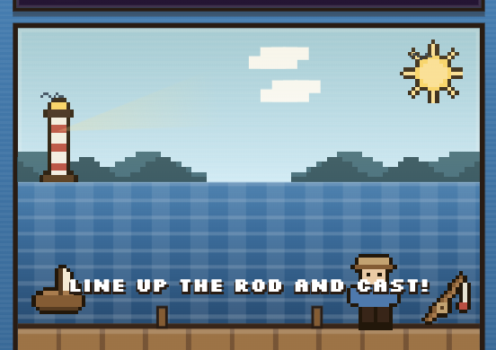

<h1>Hi, I'm Gabriel 👋</h1>

**Computer Engineering student at the University of Beira Interior**  
Covilhã, Portugal · I build small, fast, thoughtful software.

  
  
  

## About me

I'm a Computer Engineering student at **Universidade da Beira Interior** in Covilhã. I like building things end to end — native macOS utilities, web apps and the occasional game — and I care about keeping them small, fast and a little bit playful.

- 🔭 Currently building **[Pisca Pisca](https://github.com/gabrielmaria/pisca-pisca)**, a native macOS break reminder.
- 🎮 Also maintaining **[Pesca Lendária](https://pesca-lendaria.vercel.app)**, a no-build pixel-art fishing game.
- 🌱 Currently exploring **Swift/AppKit** and game economy design through side projects.
- 🌍 Portuguese · English

## Featured projects

<table>
<tr>
<td width="58%" valign="top">

### 🎣 Pesca Lendária

A pixel-art fishing tycoon that runs entirely in the browser — **no frameworks, no build step**, and every sprite is drawn on canvas by hand-written JavaScript.

Three minutes of fishing every 12 hours, with a daily boss, a deep-sea endgame and 45 species to collect.

<code>JavaScript</code> <code>Canvas</code> <code>HTML</code> <code>CSS</code>

  

</td>
<td width="42%" valign="top">

</td>
</tr>
</table>

<table>
<tr>
<td width="18%" valign="top">

</td>
<td width="82%" valign="top">

### 👁️ Pisca Pisca

A native macOS menu bar app for the **20-20-20 rule**: every 20 minutes, look at something 20 feet away for 20 seconds. The name is what you do with your eyes while you rest them.

Built with Swift and AppKit — around **0.7 MB on disk** and **15 MB of RAM**, with no Electron in sight. Bilingual (PT/EN), full-screen or corner mode, and starts with your Mac.

<code>Swift</code> <code>AppKit</code> <code>macOS</code>

</td>
</tr>
</table>

### More things I've built

| Project | What it is | Stack |
| :-- | :-- | :-- |
| **[SpinSync](https://github.com/gabrielmaria/SpinSync)** | Rate, organise and share your favourite albums with friends. | `React` `Node.js` `MongoDB` |
| **[Organizador](https://github.com/gabrielmaria/organizador)** | Availability board for a university music group, with OCR to read screenshots. | `Python` `Flask` `SQLite` |
| **[Battleship Game](https://github.com/gabrielmaria/battleship-game)** | My first project — a terminal Battleship game from my first year at university. | `C` |

## Tech I work with

**Languages**

  
  
  
  
  
  
  

**Web & backend**

  
  
  
  
  
  
  

**Tools & platforms**

  
  
  
  
  
  

## GitHub, in numbers

 

---

**Let's build something together.**  
[g.miguensmaria@gmail.com](mailto:g.miguensmaria@gmail.com) · [@gabrielmaria4](https://instagram.com/gabrielmaria4)

Thanks for stopping by 🐟

